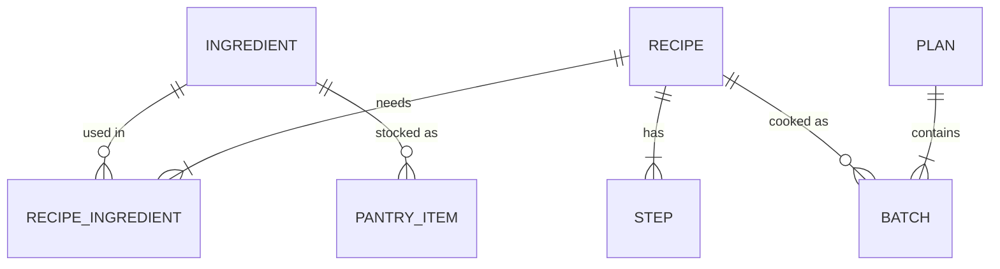

# Data Model and Optimizer

Source of truth for types, scoring, the optimization model and tests. Implement as written; ask before deviating.

## 1. Entities



The model is a small **ontology**: objects (ingredient, recipe, batch) and links (needs, cooked as). The optimizer works on these links.

## 2. Types (`src/types.ts`)

```ts
type Category = 'protein' | 'produce' | 'herb' | 'dairy' | 'grain' | 'pantry' | 'spice' | 'fruit' | 'other';
type Role = 'core' | 'optional' | 'garnish';
type MealType = 'breakfast' | 'main';

interface Ingredient {
  id: string;              // kebab-case
  name: string;
  category: Category;
  shelfLifeDays: number;   // after purchase (day 0 = shopping day)
  packUnit: string;        // unit it's SOLD in
  packSize: number;
  staple?: boolean;        // assumed owned; ignored for waste and shopping
  estimated?: boolean;     // shelf life / pack size are estimates, not sourced
  freezable?: boolean;     // raw item can go in the freezer on shopping day (raw meat, fish)
}

interface RecipeIngredient {
  ingredientId: string;
  qty: number;             // in the ingredient's packUnit, for the WHOLE recipe; 0 for staples
  role: Role;
  qtyNote?: string;        // original wording when conversion was uncertain
  substitutes?: string[];
}

interface Step { text: string; timerSec?: number; }

interface Macros { kcal: number | null; protein: number | null; carbs: number | null; fat: number | null; }

interface Recipe {
  id: string;
  title: string;
  mealType: MealType;
  minutes: number;
  difficulty: 'easy' | 'medium';
  servings: number;        // one cook = one batch = `servings` portions
  tags: string[];
  macrosPerServing: Macros;
  source: { name: string; url: string };
  ingredients: RecipeIngredient[];
  steps: Step[];
  dataFlags?: string[];    // known data doubts; show a subtle "data note" in the UI
  freezesWell?: boolean;   // cooked portions can be frozen; set only when the source's storage notes say so
}

interface PantryItem {
  ingredientId: string;
  amount: number;          // in packUnit
  addedOn: string;         // ISO date the item was entered
  daysLeftAtAdd: number;   // days of life left on addedOn
}
// daysLeft(item, startDate) = daysLeftAtAdd − (startDate − addedOn in days), floored at 0

interface Batch {
  recipeId: string;
  day: number;
  pinned: boolean;
  frozenPortions: number;  // cooked portions frozen on the cook day (0 unless freezesWell)
  reason?: string[];
}

interface Constraints {
  startDate: string;                    // ISO date of day 0 (the shopping day), default today
  days: number;                         // horizon, default 7 (day 0 = shopping day)
  proteinPerDay: number;                // grams from planned meals, default 150
  mealsPerDay: { breakfast: number; main: number }; // default { breakfast: 1, main: 2 }
  maxCookMinutes: number[];             // per day, length = days; default 60; 0 = no cooking
  cookedFoodLifeDays: number;           // default 3: a batch is eaten on days d..d+2
  frozenLifeDays: number;               // default 30: shelf life of a freezable item once frozen
  maxRepeatsPerRecipe: number;          // default 2: variety rule, batches of the same recipe per week
  pins: { recipeId: string; day: number }[];
  excluded: string[];                   // recipe ids, never planned
  excludedSlots: { recipeId: string; day: number }[]; // from Steer "remove": not this recipe on this day
  pantry: PantryItem[];
  weights: { waste: number; protein: number; cookTime: number }; // the "steer" sliders
}

interface Meal { day: number; mealType: MealType; batchIndex: number; frozen: boolean; } // one portion eaten

interface PlanResult {
  batches: Batch[];
  meals: Meal[];                        // from §5
  shopping: { ingredientId: string; packs: number; freeze: boolean }[]; // freeze = freeze on shopping day
  notes: { day: number; text: string }[]; // e.g. "move the chicken to the fridge tonight"
  wastePacks: number;                   // Σ leftover perishable, in packs
  reuseRate: number;                    // see §4
  proteinByDay: number[];
  proteinShortfall: number;             // s: average g/day below target; > 0 is a warning, not infeasible
  status: 'optimal' | 'timeout-best' | 'infeasible';
  infeasibleReason?: string;            // set when status is 'infeasible' (see §3)
  solveMs: number;
}
```

## 3. The optimization model (`src/lib/model.ts` builds it; `solve.ts` runs it; `solve.worker.ts` is a thin worker wrapper around `solve.ts`, so tests can call `solve.ts` directly)

Solver: `highs` (HiGHS compiled to WebAssembly, MILP), run in a Web Worker, with a **2 s time limit**. On timeout, return the best solution found (`timeout-best`). If none was found, fall back to the greedy plan. Show a "Solving…" state; previews (§7) never wait for the solver.

**Validated offline.** This exact model was run on `data/*.json` with an open-source MILP solver (CBC) before the build: with the defaults it is feasible, hits 150 g protein/day, and solves in 0.3–2 s. Two things were required, both now in the model: **freezing** (raw meat and fish only last ~2 days, so without it the back half of the week has no protein) and the **variety rule** (without it the optimum is the same bowl four times). Changes made since (frozen cooked portions, dropping expired optional ingredients, the pantry window) only add options or apply to a non-empty pantry, so the default week stays feasible; the regression test in §9 re-checks it.

**Indices.** Recipes *r* (eligible: not excluded, `macrosPerServing.protein != null` unless pinned), days *d* = 0…D−1, non-staple ingredients *i*.

**Good through.** An ingredient with life *N* is good **through** day *N*: with `shelfLifeDays = 2` it can be used on days 0, 1 and 2. Every expiry rule in this doc uses this reading.

**Pre-computed feasibility mask (key simplification).** One shopping trip on day 0. Recipe *r* may be cooked on day *d* only if every **core, non-staple** ingredient has an effective life ≥ *d*, and (r, d) is not in `excludedSlots`. Effective life = `frozenLifeDays` if `freezable`, else `shelfLifeDays`; a pantry item never shortens it, because a fresh pack can always be bought (pantry stock only counts toward early batches, see constraint 5). Infeasible (r, d) pairs get no variable. This handles expiry without time-indexed inventory.

**Optional ingredients are dropped when expired.** For an **optional** ingredient whose effective life < *d*, use `qty_{r,i,d} = 0`: the batch is cooked without it, and the explanation and Cook mode say so. Otherwise `qty_{r,i,d} = qty_{r,i}`. **Garnish** is never bought or counted (shopping, waste, mask, graph); Cook mode lists it as "if you have it".

**Variables.**
- `y[r,d] ∈ {0,1}`: cook one batch of *r* on day *d*
- `f[r,d] ∈ ℤ≥0`: cooked portions of that batch frozen on day *d*. Only for recipes with `freezesWell`; otherwise fixed at 0
- `b[i] ∈ ℤ≥0`: packs of *i* to buy
- `u[i] ≥ 0`: pantry amount of *i* used (only for ingredients in the pantry)
- `s ≥ 0`: average daily protein shortfall (soft constraint, so the model is never infeasible because of protein)

**Constraints.**
1. **Pins:** `y[r,d] = 1` for each pin.
2. **Cooking time:** `Σ_r minutes_r · y[r,d] ≤ maxCookMinutes[d]`.
3. **Enough food, cumulatively** (per meal type *m*, needing `n_m` portions per day): for each day *t*, `Σ_{d ≤ t, r ∈ m} servings_r · y[r,d] ≥ n_m · (t + 1)`. Frozen portions count: they can be thawed for any later day.
4. **No fresh portion spoils, cumulatively:** for each day *t*, `Σ_{d ≤ t, r ∈ m} (servings_r · y[r,d] − f[r,d]) ≤ n_m · (t + L)`, where *L* = `cookedFoodLifeDays`. Fresh portions are eaten first (§5), so this keeps every fresh portion inside its life.
   - 4a. `f[r,d] ≤ servings_r · y[r,d]`.
   - 4b. **No overcooking:** `Σ_{d, r ∈ m} servings_r · y[r,d] ≤ n_m · (D − 1 + L)`. This is the old constraint 4 at the last day; it stops the solver cooking extra frozen portions just to raise average protein.
5. **Ingredients:** `packSize_i · b[i] + u[i] ≥ Σ_{r,d} qty_{r,i,d} · y[r,d]` (core and unexpired optional; never garnish), with `u[i] ≤ pantryAmount_i` and `u[i] ≤ Σ_{d ≤ daysLeft_i} qty_{r,i,d} · y[r,d]` (pantry stock only feeds batches cooked before it expires).
6. **Variety:** for each recipe *r*, `Σ_d y[r,d] ≤ maxRepeatsPerRecipe`.
7. **Protein (soft, weekly form for tractability):** `Σ_{r,d} servings_r · protein_r · y[r,d] / D + s ≥ proteinPerDay`. Per-day protein is reported after solving (§5).

**Infeasible reasons.** Before solving, check each pin on its own and report the first failure in `infeasibleReason`: "Frittata on Sun: spinach is only good through Sat" (mask), "Mon: pinned meals need 75 min, limit is 60" (time), "Frittata makes 6 portions; 3 can be eaten fresh and it doesn't freeze well" (constraint 4), "Pinned 3 times; the limit is 2" (variety). If every pin passes alone but the solver still reports infeasible: "These pins leave no way to cover every meal." Protein never makes a plan infeasible; a shortfall is reported in `proteinShortfall` ("12 g/day short of 150 g").

**Objective (minimize).**
```
  w.waste    · Σ_i (b[i] − Σ_{r,d} qty_{r,i,d} · y[r,d] / packSize_i)   // leftover packs; perishables only (shelfLifeDays ≤ 14)
+ w.protein  · s / 10
+ w.cookTime · Σ_{r,d} minutes_r · y[r,d] / 60
```
Defaults: `waste 1.0, protein 2.0, cookTime 0.3`. The Steer sliders change these weights and re-solve.

## 4. Metrics (`src/lib/waste.ts`, pure, also used for preview)
Roles: `need` counts **core** and **unexpired optional** uses (`qty_{r,i,d}` from §3); garnish never counts.
- `need(i) = Σ qty_{r,i,d}` over the plan's batches
- `usablePantry(i) = min(pantryAmount_i, Σ qty_{r,i,d}` over batches with `d ≤ daysLeft_i)`
- `packs(i) = ceil(max(0, need(i) − usablePantry(i)) / packSize_i)`
- `leftover(i) = packs(i)·packSize_i + pantryAmount_i − need(i)` for perishables (`shelfLifeDays ≤ 14`, not staple)
- `wastePacks = Σ leftover(i) / packSize_i`. Leftover raw freezable items (meat, fish) still count as waste in v1, even if frozen. Frozen **cooked** portions are food, not waste.
- `reuseRate = |{perishable i used by ≥ 2 distinct recipes in the plan}| / |{perishable i used, bought or from the pantry}|`. Two batches of the same recipe don't count as reuse.

## 5. Post-solve schedule (`src/lib/schedule.ts`)
Assign portions to days per meal type: **fresh portions first**, first-in-first-out (oldest batch first); frozen portions fill the days fresh portions can't. The result is `meals`.
- **Freezing raw items:** for any freezable ingredient used on a day > `shelfLifeDays` (§3 "good through"), set `freeze: true` on its shopping entry ("freeze on shopping day") and add a note on the day before cooking: "move the chicken to the fridge tonight".
- **Frozen cooked portions:** note on the cook day ("freeze 3 portions"), and on the day before each one is eaten ("move 1 portion of frittata to the fridge tonight"). Portions still frozen after day D−1 are listed as "in the freezer", not as waste.

This gives `proteinByDay` and the day rows. If a fresh portion would be eaten after `day + L − 1`, flag it (constraint 4 should prevent this; the flag catches bugs).

## 6. Greedy baseline (`src/lib/greedy.ts`)
Start from the pins. Repeatedly, for the first day whose meals aren't covered, add the feasible (r, d) that minimizes Δ`wastePacks`, breaking ties by higher protein per serving, then shorter time. Feasible means constraints 2–6 still hold; for a `freezesWell` recipe, portions beyond the fresh window are frozen. This is the comparison baseline, and the fallback when the solver fails.

## 7. Steer preview (`src/lib/preview.ts`)
For a proposed edit (**move, swap or remove**; adding a recipe from the map is a swap into a day the user picks), build the edited plan and compute §4 and §5 **without re-solving** (fast, < 5 ms). Show Δ wastePacks, Δ protein on the affected days, and Δ cooking minutes.

**Apply.** Move or swap: keep the edited batch as a pin. Remove: add (recipe, day) to `excludedSlots`. Then re-solve the rest. The re-solve can change other days, so after it lands, show the final Δ against the plan before the edit ("Re-solved: −0.4 packs, +6 g protein") next to the preview's numbers.

**Weights.** The Steer sliders set `weights` (waste, protein, cooking time) and re-solve when released. They don't preview, because a weight change has no edit to preview.

## 8. Explanations (`src/lib/explain.ts`)
For each batch, generate up to 3 reasons from the model (no LLM). Ingredient reasons only cite core or optional ingredients, never garnish.
- **Shared:** "shares cilantro, lime with Tue's batch"
- **Expiry:** "uses spinach before it expires (day 4)"
- **Protein:** "+N g protein per serving"
- **Pinned:** "you pinned this"
- **Time:** "fits your 20-min limit on Wed"
- **Frozen:** "3 portions frozen for Thu–Sat"
- **Dropped:** "cooked without avocado (expires day 4)"

## 9. Required unit tests (Vitest)
- Mask: a recipe whose core perishable lasts 2 days is never placed on day ≥ 3, and can be placed on day 2 (good through).
- Pins always appear in the result; an impossible pin set returns `infeasible` with a reason.
- Cumulative food constraints: no day is short of meals; no portion is eaten after its life.
- `wastePacks` for a hand-computed 2-recipe example matches exactly.
- Adding a recipe that reuses a leftover perishable lowers `wastePacks`.
- Optimal `wastePacks` ≤ greedy `wastePacks` on the default week.
- Preview Δ equals (metrics after − metrics before).
- A 7-day solve finishes in < 2 s in the worker (or returns `timeout-best`).
- Freezing: a chicken recipe can be placed on day 5 only when `freezable` is true.
- Variety: no recipe appears in more than `maxRepeatsPerRecipe` batches.
- Default week on the real data is feasible with 0 protein shortfall at 150 g/day (regression test for the offline validation).
- Frozen cooked portions: a 6-serving breakfast with `freezesWell` can be planned at 1 breakfast/day and the schedule eats its frozen portions after the fresh ones; without `freezesWell`, pinning it returns `infeasible` with the constraint-4 reason.
- No fresh portion is eaten after its life, and frozen portions are only eaten on days fresh portions don't cover.
- Optional ingredients: an optional ingredient that expires before the cook day is not in `need` or `shopping`; garnish never is.
- Pantry: pantry stock reduces `packs` only for batches cooked on or before its `daysLeft`.
- `reuseRate`: two batches of the same recipe don't count as reuse.
- A protein target the recipes can't reach returns a plan with `proteinShortfall > 0`, not `infeasible`.

## 10. Data rules
- `data/recipes.json` and `data/ingredients.json` are the only recipe data. Never invent recipes, macros or URLs.
- Recipes with `protein: null` are excluded from auto-solve but can be pinned (show "macros not published").
- `freezesWell` is set only when the recipe's source says the cooked dish freezes; record the wording in `docs/recipes-research.md`. No recipe has it yet. The frittata's source (`b04`, 6 servings) gives fridge storage only (3–4 days, no freezing), so it stays unset and the frittata can't be planned at 1 breakfast/day; pinning it returns the constraint-4 reason.
- Shelf lives and pack sizes are estimates (`estimated: true`); show them as editable assumptions, not facts. A user's edits are stored as overrides (`ingredientId → { shelfLifeDays?, packSize? }`) in `localStorage` and applied to the data before every solve, preview and lens; `data/*.json` is never changed by the app.

## 11. Ingredient map & lenses (`src/lib/graph.ts`, `src/lib/lenses.ts`)
Pure functions only; the UI maps their output to tokens. No React or d3 imports in these files (d3-force is used only in the map component).

**Graph.**
- `buildGraph(recipes, ingredients, { includeSingleUse })` → `{ nodes, edges }`.
  - Nodes: every recipe; every **non-staple** ingredient. Ingredients used by exactly one recipe are omitted unless `includeSingleUse` (default false).
  - Edge `recipe → ingredient` for each core/optional use; `weight = qty / packSize` (fraction of a pack).
- `degree(ingredientId)` = number of distinct recipes using it.
- `neighbours(nodeId)` = directly connected node ids.
- `shared(recipeA, recipeB)` = non-staple ingredient ids used by both.

**Families (clusters).** Project to a recipe–recipe graph where edge weight = number of shared **perishable** ingredients (`shelfLifeDays ≤ 14`). Run **label propagation**, deterministic: nodes visited in id order, ties broken by smallest label, max 20 iterations. Name each family by its top 2 perishables by within-family degree ("cilantro–lime"). Families of size 1 are labelled "standalone".

**Absorbers.** `absorbers(ingredientId, plan, constraints)` = **swaps**: replace a planned, unpinned batch with a recipe of the same meal type on the same day that uses the ingredient. Adding a batch would break constraint 4, so absorbers never add. Keep only swaps where constraints 2–6 still hold, ranked by Δ`wastePacks` from `preview.ts` (most negative first). The Waste lens shows the top one ("Swap in the tuna salad Thu → −0.6 packs").

**Lenses.** `lens(name, ctx)` returns:
```ts
interface LensResult {
  nodes: Record<string, { emphasis: 'high' | 'normal' | 'dim'; size?: number; label?: string; badge?: string; family?: string }>;
  ghostEdges?: { from: string; to: string; label: string }[];  // Waste lens suggestions
  sentence: string;   // the one-line key insight
  list: string[];     // text equivalent of everything the lens shows
}
```
| Lens | Rule |
|---|---|
| `week` | Planned recipes and the ingredients they use: `high`; everything else `dim`. Sentence: batches count and shared-ingredient count. |
| `hubs` | Ingredient `size` ∝ degree; top 5 perishables by degree get labels. Recipes `normal`. |
| `freshness` | Ingredient badge = days left as of today (pantry `daysLeft` computed from `addedOn`, else `shelfLifeDays` counted from `startDate`). ≤ 2 days: `high`; recipes using those: `high`. |
| `waste` | Ingredients with `leftover > 0` in the current plan: `high` with badge "+0.6 pack"; one ghost edge to the best absorber, labelled with its Δ. |
| `protein` | Recipe `size` ∝ protein per serving; < 30 g: `dim`; `protein == null`: `dim` + badge "n/a". |
| `families` | `family` set on every recipe node; sentence names the family the current plan mostly sits in. |

**Layout.** Run d3-force for a fixed 300 ticks with nodes seeded deterministically (by id hash), then render static. No continuous animation; same data → same picture.

**Tests (add to §9).**
- Staples never appear as nodes; single-use ingredients appear only with `includeSingleUse`.
- `degree` matches a hand count for garlic and lemon in the fixture data.
- `shared(a, b)` is symmetric.
- Label propagation is deterministic (same input → same families, twice).
- Every perishable used by ≥ 2 recipes in one family keeps them in the same family in a 3-recipe fixture.
- The Waste lens's ghost edge points to the absorber with the most negative Δ, and Δ equals `preview.ts` output.
- Every lens returns a non-empty `sentence` and a `list` that mentions every `high` node.
- Absorbers are swaps only: every candidate replaces an unpinned batch of the same meal type and day, and keeps constraints 2–6.

## 12. Kitchen (`src/lib/kitchen.ts`)
Pure functions for the Kitchen screen.
- `daysLeft(item, date)`: from `addedOn` and `daysLeftAtAdd` (§2), floored at 0. Use-soon tag when ≤ 2 days.
- `rankByOverlap(recipes, pantry, date)`: for each recipe, `overlap` = number of distinct **perishable** pantry ingredients it uses (core or optional). Sort by overlap (descending), then by the soonest `daysLeft` among those ingredients (ascending), then by protein per serving (descending). Recipes with overlap 0 come last. The recipe row shows "Uses N of yours".

**Tests.** `daysLeft` counts down by one per calendar day and never goes below 0; ranking puts a recipe using a 1-day-left item above one using a 4-day-left item at equal overlap.

## 13. Example data (`data/fridges.json`, `data/weeks.json`)
Demo and test seeds built only from ingredients and recipes in `data/*.json`. They are not recipe data.

**Fridges.** `{ id, name, description, items: { ingredientId, amount, daysLeft }[] }`. `amount` is in the ingredient's `packUnit`; `daysLeft` is counted from the day the example is loaded, so the demo never goes stale. Loading converts each item to a `PantryItem` with `addedOn = today` and `daysLeftAtAdd = daysLeft`.
- `fresh-shop`: full packs of the most-shared ingredients, bought today.
- `end-of-week`: half-used perishables 1–3 days from turning (the waste story).
- `almost-bare`: a few long-life items.

**Weeks.** `{ id, name, description, fridgeId: string | null, proteinPerDay, maxCookMinutes, pins }`. Loading merges these over the `Constraints` defaults (`startDate` = today); `fridgeId` picks the pantry (`null` = empty).
- `standard`: the defaults and an empty fridge; the same week as the offline validation.
- `use-it-up`: `end-of-week` fridge, defaults otherwise.
- `busy-weekdays`: `fresh-shop` fridge, `maxCookMinutes` `[90, 30, 30, 60, 30, 0, 60]`.
- `favourites`: `fresh-shop` fridge, 170 g target, three pins; may end protein-short.
- `pin-conflict`: a 45-min recipe pinned on a 20-min day; must return `infeasible` with the time reason.

**Tests.** Every id resolves; no fridge item is a staple or appears twice; `1 ≤ daysLeft ≤ shelfLifeDays`; `maxCookMinutes` has `days` entries; every pin passes the mask and time limit except in `pin-conflict`; `standard` solves with 0 shortfall (it is the §9 regression week); `pin-conflict` returns `infeasible`.
