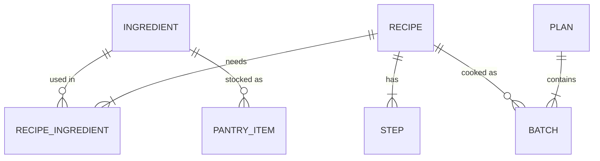

# Data Model and Optimizer

Source of truth for types, scoring, the optimization model and tests. Implement as written; ask before deviating.

## 1. Entities



The model is a small **ontology**: objects (ingredient, recipe, batch) and links (needs, cooked as). The optimizer works on these links.

## 2. Types (`src/types.ts`)

```ts
type Category = 'protein' | 'produce' | 'herb' | 'dairy' | 'grain' | 'pantry' | 'spice' | 'fruit' | 'other';
type Role = 'core' | 'optional' | 'garnish';
type MealType = 'breakfast' | 'main';

interface Ingredient {
  id: string;              // kebab-case
  name: string;
  category: Category;
  shelfLifeDays: number;   // after purchase (day 0 = shopping day)
  packUnit: string;        // unit it's SOLD in
  packSize: number;
  staple?: boolean;        // assumed owned; ignored for waste and shopping
  estimated?: boolean;     // shelf life / pack size are estimates, not sourced
  freezable?: boolean;     // raw item can go in the freezer on shopping day (raw meat, fish)
}

interface RecipeIngredient {
  ingredientId: string;
  qty: number;             // in the ingredient's packUnit, for the WHOLE recipe; 0 for staples
  role: Role;
  qtyNote?: string;        // original wording when conversion was uncertain
  substitutes?: string[];
}

interface Step { text: string; timerSec?: number; }

interface Macros { kcal: number | null; protein: number | null; carbs: number | null; fat: number | null; }

interface Recipe {
  id: string;
  title: string;
  mealType: MealType;
  minutes: number;
  difficulty: 'easy' | 'medium';
  servings: number;        // one cook = one batch = `servings` portions
  tags: string[];
  macrosPerServing: Macros;
  source: { name: string; url: string };
  ingredients: RecipeIngredient[];
  steps: Step[];
  dataFlags?: string[];    // known data doubts; show a subtle "data note" in the UI
}

interface PantryItem { ingredientId: string; amount: number; daysLeft: number; } // amount in packUnit

interface Batch { recipeId: string; day: number; pinned: boolean; reason?: string[]; }

interface Constraints {
  days: number;                         // horizon, default 7 (day 0 = shopping day)
  proteinPerDay: number;                // grams from planned meals, e.g. 150
  mealsPerDay: { breakfast: number; main: number }; // default { breakfast: 1, main: 2 }
  maxCookMinutes: number[];             // per day, length = days; default 60; 0 = no cooking
  cookedFoodLifeDays: number;           // default 3: a batch is eaten on days d..d+2
  frozenLifeDays: number;               // default 30: shelf life of a freezable item once frozen
  maxRepeatsPerRecipe: number;          // default 2: variety rule, batches of the same recipe per week
  pins: { recipeId: string; day: number }[];
  excluded: string[];                   // recipe ids
  pantry: PantryItem[];
  weights: { waste: number; protein: number; cookTime: number }; // the "steer" sliders
}

interface PlanResult {
  batches: Batch[];
  shopping: { ingredientId: string; packs: number }[];
  wastePacks: number;                   // Σ leftover perishable, in packs
  reuseRate: number;                    // see §4
  proteinByDay: number[];
  status: 'optimal' | 'timeout-best' | 'infeasible';
  solveMs: number;
}
```

## 3. The optimization model (`src/lib/model.ts` builds it; `solve.worker.ts` runs it)

Solver: `highs` (HiGHS compiled to WebAssembly, MILP), run in a Web Worker, with a **2 s time limit**. On timeout, return the best solution found (`timeout-best`). If none was found, fall back to the greedy plan. Show a "Solving…" state; previews (§7) never wait for the solver.

**Validated offline.** This exact model was run on `data/*.json` with an open-source MILP solver (CBC) before the build: with the defaults it is feasible, hits 150 g protein/day, and solves in 0.3–2 s. Two things were required, both now in the model: **freezing** (raw meat and fish only last ~2 days, so without it the back half of the week has no protein) and the **variety rule** (without it the optimum is the same bowl four times).

**Indices.** Recipes *r* (eligible: not excluded, `macrosPerServing.protein != null` unless pinned), days *d* = 0…D−1, non-staple ingredients *i*.

**Pre-computed feasibility mask (key simplification).** One shopping trip on day 0. Recipe *r* may be cooked on day *d* only if every **core, non-staple** ingredient has an effective life ≥ *d*: `frozenLifeDays` if `freezable`, else `shelfLifeDays` (or pantry `daysLeft`). Infeasible (r, d) pairs get no variable. This handles expiry without time-indexed inventory.

**Variables.**
- `y[r,d] ∈ {0,1}`: cook one batch of *r* on day *d*
- `b[i] ∈ ℤ≥0`: packs of *i* to buy
- `s ≥ 0`: average daily protein shortfall (soft constraint, so the model is never infeasible because of protein)

**Constraints.**
1. **Pins:** `y[r,d] = 1` for each pin.
2. **Cooking time:** `Σ_r minutes_r · y[r,d] ≤ maxCookMinutes[d]`.
3. **Enough food, cumulatively** (per meal type *m*, needing `n_m` portions per day): for each day *t*, `Σ_{d ≤ t, r ∈ m} servings_r · y[r,d] ≥ n_m · (t + 1)`.
4. **Nothing cooked spoils, cumulatively:** for each day *t*, `Σ_{d ≤ t, r ∈ m} servings_r · y[r,d] ≤ n_m · (t + L)`, where *L* = `cookedFoodLifeDays`.
5. **Ingredients:** `packSize_i · b[i] + pantryAmount_i ≥ Σ_{r,d} qty_{r,i} · y[r,d]` (core and optional roles).
6. **Variety:** for each recipe *r*, `Σ_d y[r,d] ≤ maxRepeatsPerRecipe`.
7. **Protein (soft, weekly form for tractability):** `Σ_{r,d} servings_r · protein_r · y[r,d] / D + s ≥ proteinPerDay`. Per-day protein is reported after solving (§5).

**Objective (minimize).**
```
  w.waste    · Σ_i (b[i] − Σ_{r,d} qty_{r,i} · y[r,d] / packSize_i)   // leftover packs; perishables only (shelfLifeDays ≤ 14)
+ w.protein  · s / 10
+ w.cookTime · Σ_{r,d} minutes_r · y[r,d] / 60
```
Defaults: `waste 1.0, protein 2.0, cookTime 0.3`. The Steer sliders change these weights and re-solve.

## 4. Metrics (`src/lib/waste.ts`, pure, also used for preview)
- `need(i) = Σ qty_{r,i}` over the plan's batches
- `packs(i) = ceil(max(0, need(i) − pantryAmount_i) / packSize_i)`
- `leftover(i) = packs(i)·packSize_i + pantryAmount_i − need(i)` for perishables (`shelfLifeDays ≤ 14`, not staple)
- `wastePacks = Σ leftover(i) / packSize_i`
- `reuseRate = |{perishable i used by ≥ 2 batches}| / |{perishable i used}|`

## 5. Post-solve schedule (`src/lib/schedule.ts`)
Assign portions to days first-in-first-out (oldest batch first), per meal type. For any freezable ingredient used on day ≥ `shelfLifeDays`, add "freeze on shopping day" to the shopping list and a "move to the fridge tonight" note on the day before cooking. This gives `proteinByDay` and the day rows. If a portion would be eaten after `day + L − 1`, flag it (constraint 4 should prevent this; the flag catches bugs).

## 6. Greedy baseline (`src/lib/greedy.ts`)
Start from the pins. Repeatedly, for the first day whose meals aren't covered, add the feasible (r, d) that minimizes Δ`wastePacks`, breaking ties by higher protein per serving, then shorter time. This is the comparison baseline, and the fallback when the solver fails.

## 7. Steer preview (`src/lib/preview.ts`)
For a proposed edit (move, swap, remove), build the edited plan and compute §4 and §5 **without re-solving** (fast, < 5 ms). Show Δ wastePacks, Δ protein on the affected days, and Δ cooking minutes. Apply = keep the edit as a pin and re-solve the rest.

## 8. Explanations (`src/lib/explain.ts`)
For each batch, generate up to 3 reasons from the model (no LLM):
- **Shared:** "shares cilantro, lime with Tue's batch"
- **Expiry:** "uses spinach before it expires (day 4)"
- **Protein:** "+N g protein per serving"
- **Pinned:** "you pinned this"
- **Time:** "fits your 20-min limit on Wed"

## 9. Required unit tests (Vitest)
- Mask: a recipe whose core perishable lasts 2 days is never placed on day ≥ 3.
- Pins always appear in the result; an impossible pin set returns `infeasible` with a reason.
- Cumulative food constraints: no day is short of meals; no portion is eaten after its life.
- `wastePacks` for a hand-computed 2-recipe example matches exactly.
- Adding a recipe that reuses a leftover perishable lowers `wastePacks`.
- Optimal `wastePacks` ≤ greedy `wastePacks` on the default week.
- Preview Δ equals (metrics after − metrics before).
- A 7-day solve finishes in < 2 s in the worker (or returns `timeout-best`).
- Freezing: a chicken recipe can be placed on day 5 only when `freezable` is true.
- Variety: no recipe appears in more than `maxRepeatsPerRecipe` batches.
- Default week on the real data is feasible with 0 protein shortfall at 150 g/day (regression test for the offline validation).

## 10. Data rules
- `data/recipes.json` and `data/ingredients.json` are the only recipe data. Never invent recipes, macros or URLs.
- Recipes with `protein: null` are excluded from auto-solve but can be pinned (show "macros not published").
- Shelf lives and pack sizes are estimates (`estimated: true`); show them as editable assumptions, not facts.

## 11. Ingredient map & lenses (`src/lib/graph.ts`, `src/lib/lenses.ts`)
Pure functions only; the UI maps their output to tokens. No React or d3 imports in these files (d3-force is used only in the map component).

**Graph.**
- `buildGraph(recipes, ingredients, { includeSingleUse })` → `{ nodes, edges }`.
  - Nodes: every recipe; every **non-staple** ingredient. Ingredients used by exactly one recipe are omitted unless `includeSingleUse` (default false).
  - Edge `recipe → ingredient` for each core/optional use; `weight = qty / packSize` (fraction of a pack).
- `degree(ingredientId)` = number of distinct recipes using it.
- `neighbours(nodeId)` = directly connected node ids.
- `shared(recipeA, recipeB)` = non-staple ingredient ids used by both.

**Families (clusters).** Project to a recipe–recipe graph where edge weight = number of shared **perishable** ingredients (`shelfLifeDays ≤ 14`). Run **label propagation**, deterministic: nodes visited in id order, ties broken by smallest label, max 20 iterations. Name each family by its top 2 perishables by within-family degree ("cilantro–lime"). Families of size 1 are labelled "standalone".

**Absorbers.** `absorbers(ingredientId, plan, constraints)` = feasible (recipe, day) pairs not in the plan that use the ingredient, ranked by Δ`wastePacks` from `preview.ts` (most negative first). The Waste lens shows the top one.

**Lenses.** `lens(name, ctx)` returns:
```ts
interface LensResult {
  nodes: Record<string, { emphasis: 'high' | 'normal' | 'dim'; size?: number; label?: string; badge?: string; family?: string }>;
  ghostEdges?: { from: string; to: string; label: string }[];  // Waste lens suggestions
  sentence: string;   // the one-line key insight
  list: string[];     // text equivalent of everything the lens shows
}
```
| Lens | Rule |
|---|---|
| `week` | Planned recipes and the ingredients they use: `high`; everything else `dim`. Sentence: batches count and shared-ingredient count. |
| `hubs` | Ingredient `size` ∝ degree; top 5 perishables by degree get labels. Recipes `normal`. |
| `freshness` | Ingredient badge = days left (pantry `daysLeft`, else `shelfLifeDays` from shopping day). ≤ 2 days: `high`; recipes using those: `high`. |
| `waste` | Ingredients with `leftover > 0` in the current plan: `high` with badge "+0.6 pack"; one ghost edge to the best absorber, labelled with its Δ. |
| `protein` | Recipe `size` ∝ protein per serving; < 30 g: `dim`; `protein == null`: `dim` + badge "n/a". |
| `families` | `family` set on every recipe node; sentence names the family the current plan mostly sits in. |

**Layout.** Run d3-force for a fixed 300 ticks with nodes seeded deterministically (by id hash), then render static. No continuous animation; same data → same picture.

**Tests (add to §9).**
- Staples never appear as nodes; single-use ingredients appear only with `includeSingleUse`.
- `degree` matches a hand count for garlic and lemon in the fixture data.
- `shared(a, b)` is symmetric.
- Label propagation is deterministic (same input → same families, twice).
- Every perishable used by ≥ 2 recipes in one family keeps them in the same family in a 3-recipe fixture.
- The Waste lens's ghost edge points to the absorber with the most negative Δ, and Δ equals `preview.ts` output.
- Every lens returns a non-empty `sentence` and a `list` that mentions every `high` node.
